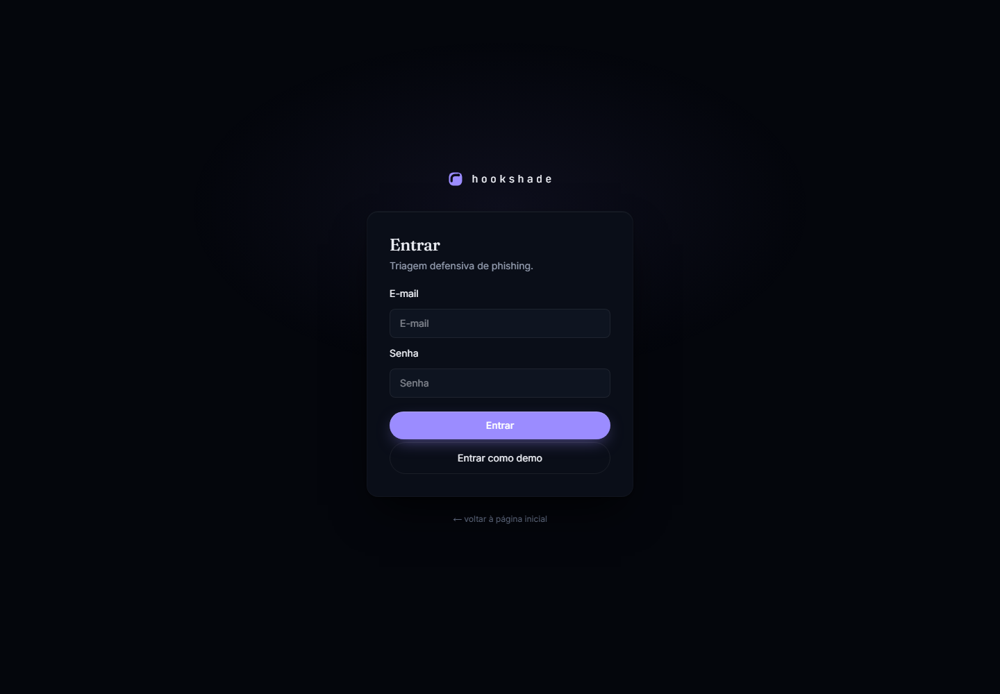
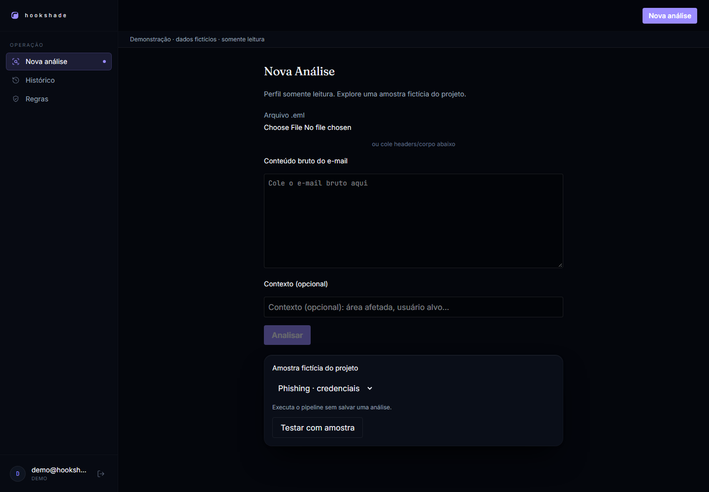
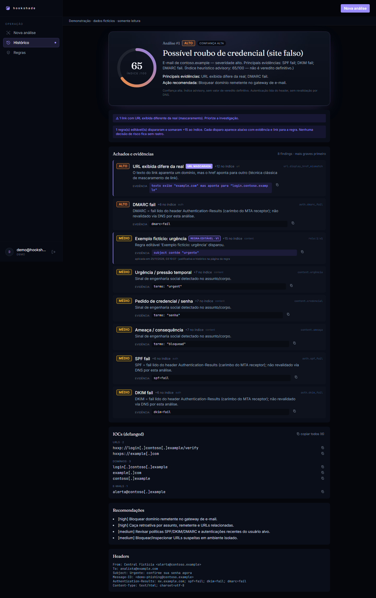
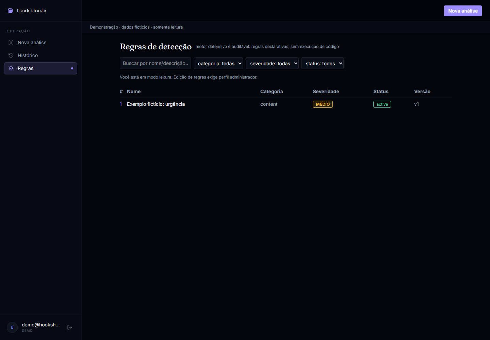
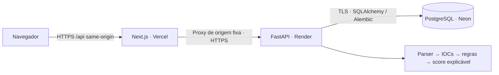

# Hookshade

Hookshade is a full-stack phishing triage portfolio built with FastAPI, Next.js and PostgreSQL.
It explains risk through evidence and offers a demo with fictional samples and ephemeral email analysis.

Plataforma defensiva para triagem de phishing em SOC: upload de `.eml` ou texto bruto → parser → IOCs → leitura de SPF/DKIM/DMARC dos headers → detecção de URLs mascaradas → índice de risco explicável, evidências e recomendações. Regras declarativas, histórico e auditoria completam o fluxo. O pipeline **não faz chamadas externas**, não abre URLs nem executa anexos.

**[Abrir a aplicação](https://hookshade.vercel.app)** · Vercel + Render + Neon.
A API pode levar cerca de um minuto para acordar no plano gratuito do Render. A tela avisa após 3 segundos e tenta novamente automaticamente. O botão **Entrar como demo** aparece quando o operador habilita o perfil no backend.

## Explorar a demonstração

1. Na tela de login, selecione **Entrar como demo**, sem informar uma senha.
2. Abra uma das quatro análises fictícias no histórico e confira score, evidências e IOCs defanged.
3. Consulte as regras ou abra **Nova análise → Testar com amostra** para executar uma mensagem do projeto sem salvar dados.
4. Em **Nova análise**, cole um e-mail ou selecione um `.eml`: o resultado efêmero aparece na própria página. O conteúdo é analisado em memória e descartado; nada é salvo no histórico ou na auditoria.

O preview aceita até 64 KB em UTF-8, com 5 análises por minuto e 30 por hora por IP, além de um teto global de 300 por hora. Esses limites são configuráveis por `PREVIEW_MAX_BYTES`, `PREVIEW_RATE_PER_MINUTE`, `PREVIEW_RATE_PER_HOUR` e `PREVIEW_GLOBAL_PER_HOUR`. O estado do rate limit vive no processo, com uma instância/worker no Render; o teto global limita o abuso mesmo com `X-Forwarded-For` forjado. A interface informa os valores padrão.

O demo continua sem permissão para salvar análises, excluir, alterar regras ou administrar usuários (`403` no backend). A faixa no topo identifica os dados fictícios do histórico. Use exclusivamente mensagens fictícias ou sem dados pessoais neste portfólio. O índice é heurístico e depende da avaliação humana; SPF/DKIM/DMARC são lidos dos headers, sem revalidação DNS.

## Telas

Capturas reais geradas pelo Playwright. A origem e as limitações da execução local estão no [resultado da spec 01](docs/tasks/01-resultado.md).

| Login | Nova análise |
|---|---|
|  |  |
| Resultado | Regras |
|  |  |

## Arquitetura



O navegador usa `/api/*`; `BACKEND_INTERNAL_URL` é server-side. O JWT fica em cookie `HttpOnly`, com CSRF assinado para métodos mutáveis. Em produção, o cookie usa `Secure`, `SameSite=Lax`, `Path=/`, sem `Domain` e prefixo `__Host-`.

Papéis: `admin` gerencia usuários e regras; `analyst` trabalha com as próprias análises; `demo` consulta as próprias análises seed, testa amostras e analisa mensagens de forma efêmera. O papel legado `viewer` continua suportado. Usuários e auditoria global são exclusivos do admin, tanto na interface quanto na API.

## Rodar localmente

Requer Docker Engine e Compose v2.24+. Os valores de `.env.example` são placeholders públicos de desenvolvimento, carregados pelo Compose; não é necessário criar um arquivo de segredos.

```bash
docker compose up --build
# http://localhost:3000 → Entrar como demo
# Admin local: admin@example.com / dev-only-admin-placeholder
```

O Compose espera o Postgres ficar saudável, aplica as migrações, roda o seed e inicia API e web. As duas imagens da aplicação usam build multi-stage e usuário sem root. O banco persiste em volume Docker; somente a porta web é publicada em loopback. Um `.env` opcional na raiz sobrescreve os valores da API; ao trocar a credencial do Postgres, ajuste também `HOOKSHADE_DATABASE_URL`. Nunca use esses placeholders em produção.

Sem Docker, instale Python 3.12+ e Node 24; em dois terminais:

```bash
cd backend
python -m venv .venv
# Ative .venv conforme seu sistema.
pip install -r requirements.txt
alembic upgrade head
python -m app.seed
uvicorn app.main:app --reload --port 8000
```

```bash
cd frontend
npm ci
# BACKEND_INTERNAL_URL=http://localhost:8000 (padrão)
npm run dev
```

Configure `HOOKSHADE_SEED_EMAIL` e `HOOKSHADE_SEED_PASSWORD` no ambiente ou em `backend/.env` a partir de `backend/.env.example`. Para habilitar o demo, configure também `DEMO_ENABLED=true` e `DEMO_PASSWORD` antes de executar o seed. A configuração completa do ambiente Compose está em `.env.example` na raiz.

## Verificar

```bash
cd backend
python -m pytest -q

cd ../frontend
npm ci
npx tsc --noEmit
npm run lint
npm test
npm run build

cd ..
docker compose up --build --wait --wait-timeout 240
cd e2e
npm ci
npx playwright install --with-deps chromium
npm test
# CAPTURE_DOCS=true npm test  # atualiza docs/img com o ambiente em execução
```

Verificados: **252 testes pytest, 18 testes Vitest/RTL/MSW e 1 fluxo Playwright**. Typecheck, lint e build de produção passaram. O Playwright local usou API/SQLite descartável; a execução via Compose/Postgres permanece pendente por restrição de acesso ao Docker engine. Saídas e detalhes: [docs/tasks/01-resultado.md](docs/tasks/01-resultado.md).

O workflow `e2e.yml` executa Playwright contra Compose/Postgres e publica relatório e capturas. Os workflows usam permissões mínimas e actions fixadas por SHA, conferidas na API do GitHub ([registro](docs/tasks/01-actions-verificados.json)).

## Controles de segurança e testes

| Controle | Código | Cobertura |
|---|---|---|
| Cookie HttpOnly, Secure, `__Host-`, expiração | `backend/app/cookies.py`, `config.py` | `test_cookie_session.py`, `test_cookie_config.py` |
| CSRF assinado, inclusive login/demo | `backend/app/csrf.py`, `main.py` | `test_csrf.py`, `test_portfolio.py` |
| bcrypt e segredos obrigatórios em produção | `backend/app/security.py`, `config.py` | `test_security.py`, `test_config_hardening.py` |
| Bloqueio de conta e rate limit | `backend/app/routers/auth.py`, `ratelimit.py` | `test_login_lockout.py`, `test_rate_limit.py`, `test_portfolio.py` |
| Revogação JWT por `token_version` | `security.py`, `deps.py`, routers `auth.py` e `users.py` | `test_portfolio.py`, `test_migrations.py`, E2E |
| RBAC e isolamento de análises | `backend/app/deps.py`, routers | `test_rbac.py`, `test_analysis_ownership.py`, matriz demo em `test_portfolio.py` |
| Cifra e redação de PII | `backend/app/crypto.py`, `redaction.py` | `test_privacy.py`, `test_redaction*.py`, `test_log_redaction.py` |
| Regras declarativas e proteção contra ReDoS | `backend/app/rules/validation.py`, `engine.py` | `test_rules_validation.py`, `test_rules_engine.py` |
| CSP com nonce, anti-frame e demais headers | `frontend/proxy.ts`, `next.config.ts`, `backend/app/security_headers.py` | `test_security_headers.py`, Playwright `portfolio.spec.ts` |
| Estado demo, guardas e cold start | `frontend/components/AppShell.tsx`, `ApiWakeup.tsx` | `frontend/tests/portfolio.test.tsx` (Vitest/RTL/MSW) |
| Preview efêmero, sem gravação, CSRF, limite UTF-8 e rate limit por IP/global | `backend/app/routers/analyses.py`, `ratelimit.py`, `frontend/app/nova-analise/page.tsx` | `backend/tests/test_preview.py`, `frontend/tests/portfolio.test.tsx`, `e2e/tests/portfolio.spec.ts` |

Nomes de testes sem diretório são relativos a `backend/tests/`.

O demo compartilhado tem JWT e cookie com validade própria (`DEMO_SESSION_MINUTES`, padrão
30 minutos). Seu logout só remove o cookie do navegador, sem incrementar `token_version`
nem encerrar sessões de outros visitantes. A duração vale tanto para `/auth/demo` quanto
para o login comum do papel demo. A regressão é coberta por `test_demo_sessions.py`.
Analyst e admin mantêm a revogação por conta após logout, troca de senha e bloqueio.

## Operação e limites

- Para contas comuns, logout, troca de senha, desativação e lockout revogam JWTs pela versão no banco, em todas as sessões da conta. Tokens anteriores à migração são rejeitados.
- No demo, logout só limpa o cookie local: uma cópia do JWT permanece válida até expirar (padrão 30 minutos). Falhas de senha mantêm o lockout temporário, sem incrementar a versão demo. Ações administrativas e rotação de senha pelo seed ainda podem revogar sessões demo.
- Compose habilita `HOOKSHADE_E2E_SEED_ENABLED=true` para criar o analyst fictício `e2e-analyst@example.com`, com senha pública `e2e-only-analyst-placeholder`, usado no teste E2E de revogação. A opção é desligada por padrão e ignorada em produção; nunca habilite essas credenciais em um serviço público.
- Rate limit em memória, por processo; múltiplas instâncias exigem armazenamento compartilhado.
- Purga de retenção existe (`python -m app.tasks.purge`), mas ainda precisa de agendamento.
- Free tier pode dormir ou impor limites de disponibilidade. Não há monitoramento nem backup automático configurados.
- Sem rotação versionada da chave Fernet nem resistência da auditoria a adulteração pelo operador do banco.
- Este portfólio usa dados fictícios; não é um serviço multiusuário pronto para processar e-mails reais.

[Deploy e habilitação do demo](docs/operations/deploy.md) · [Backup/restore](docs/operations/backup-restore.md) · [Rollback](docs/operations/rollback.md) · [CI/CD](docs/operations/ci-cd.md).
